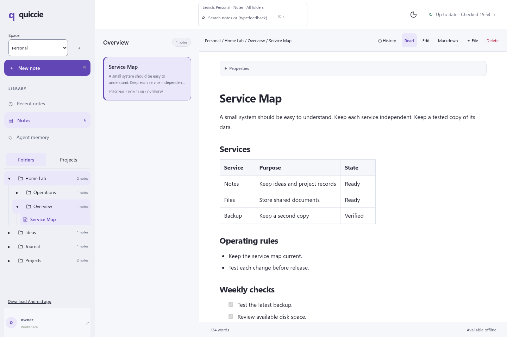
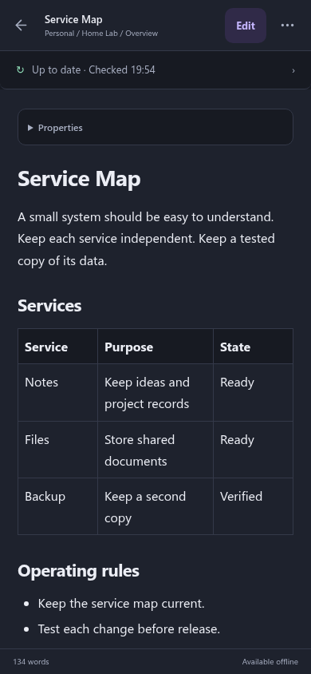
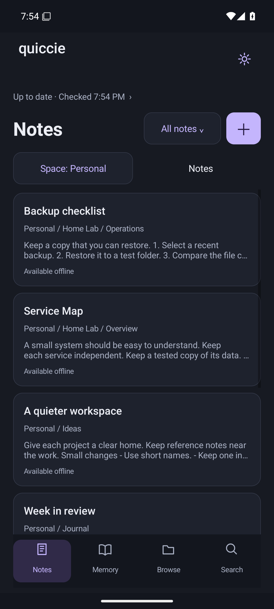

# Quiccie

Notes for people. Scoped memory for agents.

Quiccie is a self-hosted notes application with a browser interface and an Android app.
It keeps notes and pending edits on each device for offline use.
Spaces separate personal notes, work notes, projects, and agent memory.
An MCP service gives agents scoped search and revision-checked writes.

This is a pre-release project. Test it with a copy of your data before use.
Quiccie is a single-account service. Spaces organize data; they are not access-control boundaries.



| Phone browser | Android app |
| --- | --- |
|  |  |

All screenshots use fictional notes. See [the screenshot procedure](design/README.md).

## Features

- Markdown, tables, code blocks, properties, links, and attachments.
- Separate Notes and Agent memory destinations.
- Folder and project browsing with retained locations.
- Offline edits, sync status, revision history, and conflict review.
- Light and dark themes.
- A pure-Go server with bbolt storage and a rebuildable Bleve search index.
- A browser interface built with DaisyUI and Tiptap.
- Scoped MCP tools for Codex, Claude, and other MCP clients.

## Start a local server

Install Go at the version in `go.mod`, Node.js 22 or later, and npm.
Run these commands from the repository root:

```sh
npm --prefix web ci
npm --prefix web run build
CGO_ENABLED=0 go build -trimpath -buildvcs=false -o dist/quiccie ./cmd/quiccie
mkdir -p data
umask 077
read -r -s -p 'Password: ' QUICCIE_PASSWORD; printf '\n'
printf '%s' "$QUICCIE_PASSWORD" | ./dist/quiccie -mode hash-password > data/password.hash
unset QUICCIE_PASSWORD
./dist/quiccie -db data/quiccie.db -password-hash-file data/password.hash -web web/dist
```

Open `http://127.0.0.1:8090`. The default username is `owner`.
Use `-username` to select another username.
Use a TLS reverse proxy before remote access. See [deployment](docs/DEPLOYMENT.md).
Keep the MCP listener on loopback. Give remote agents a restricted SSH bridge.

## Android

Install Java 17 and Android SDK 35.
Set `ANDROID_HOME` or the ignored `android/local.properties` file.

```sh
mkdir -p android/app/src/main/assets
cp -r web/dist/. android/app/src/main/assets/
python3 scripts/sign-android.py
```

The signing script creates a private key under `.private/` on its first run.
Keep that key for future updates. Never include it in a release.
The public Android application ID is `app.quiccie.android`.
A build with a different application ID does not update an existing installation.

## Agents and spaces

See [agent integration](agent-integration/README.md) for the shared memory policy and setup checks.
See [spaces](docs/SPACES.md) for scope rules and storage layout.
See [navigation](docs/NAVIGATION-DESTINATIONS.md) for the interface model.

## Tests and release

See [the development workflow](docs/WORKFLOW.md), [validation](docs/VALIDATION.md),
and [the release checklist](docs/RELEASE.md).
Keep credentials, real notes, private registries, and deployment overrides out of Git.
Use `scripts/export-public.py` to create a source archive from tracked files.

## License

Original code uses [0BSD](LICENSE).
Dependencies keep their own licenses and notices.
See [license details](docs/LICENSES.md).
